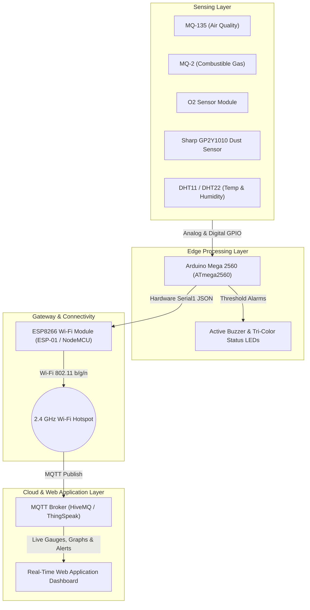

# AirGuard IoT

> **An IoT-Based Smart Air Quality, Gas Leakage, and Environmental Monitoring System Using Arduino Mega 2560, ESP8266, and Real-Time Web Application**

[](https://github.com/fahadrahman444/AirGuard-IOT)
[](https://www.arduino.cc/)
[](https://mqtt.org/)
[](LICENSE)

---

## Academic Information

* **Institution:** University of Information Technology and Sciences (UITS)
* **Department:** Department of Computer Science & Engineering (CSE)
* **Course Code:** CSE402
* **Course Title:** Internet of Things Lab
* **Semester:** 7th Semester (Autumn 2026)
* **Submitted to:** Abrar Mahbub Tanim, Lecturer, Department of CSE, UITS
* **Submitted by (Project Team):**
  * **MD. Fahad Rahman** (ID: `0432320005101071`)
  * **Zannatul Nayem** (ID: `0432320005101063`)
  * **Shafayet Hossain Shafin** (ID: `0432320005101088`)
  * **Batch:** 54th Batch  |  **Section:** 6B1

---

## 📄 Official Project Proposal Document

* **Proposal PDF:** [AirGuard_IoT_Project_Proposal.pdf](AirGuard_IoT_Project_Proposal.pdf) *(Formatted according to official UITS academic standards)*
* **Markdown Proposal:** [docs/project_proposal.md](docs/project_proposal.md)

---

## 1. Project Overview

**AirGuard IoT** is an end-to-end edge-to-cloud environmental monitoring station designed to detect atmospheric degradation, combustible gas leaks, oxygen depletion, and airborne dust particles in real time. 

By combining the high-capacity deterministic data acquisition of an **Arduino Mega 2560** with the wireless networking capabilities of an **ESP8266 Wi-Fi** module, the system bridges local multi-sensor physical telemetry with a custom-developed **Real-Time Web Application** over the lightweight **MQTT** protocol.

---

## 2. Key Features

- **Multi-Gas Air Quality Monitoring:** Continuously quantifies indoor/ambient air pollution (CO₂, NH₃, benzene, smoke) via an MQ-135 sensor.
- **Harmful Gas Leakage Detection:** Detects flammable and toxic gas leaks (LPG, propane, methane) with an MQ-2 sensor to avoid fire hazards.
- **Oxygen Concentration Measurement:** Real-time percentage measurement (% O₂) using an electrochemical oxygen sensor to prevent asphyxiation in confined spaces.
- **Particulate Matter (Dust) Detection:** Optical dust sensing (Sharp GP2Y1010AU0F) to assess fine suspended particulates in µg/m³.
- **Climate Monitoring:** Digital temperature and relative humidity tracking using a DHT11/DHT22 sensor.
- **Dual-Layer Alert System:** Instantaneous on-site audio-visual alarms (active buzzer + tri-color LEDs) paired with remote cloud/web alert banners.
- **Real-Time Web Dashboard:** Responsive web interface with interactive gauges, live time-series charts, and historical telemetry archives (superseding character LCD hardware constraints).

---

## 3. System Architecture



---

## 4. Repository Structure

```
AirGuard-IOT/
├── AirGuard_IoT_Project_Proposal.pdf  # Official submission PDF (A4 UITS theme)
├── docs/
│   ├── AirGuard_IoT_Project_Proposal.pdf
│   ├── project_proposal.md            # Markdown proposal with academic metadata
│   └── assets/
│       └── uits_logo.png              # Official UITS university crest
├── hardware/
│   ├── pinout.md                      # Mega 2560 pin mapping & wiring schematics
│   └── bill_of_materials.md           # Complete components list & specifications
├── firmware/
│   ├── arduino_airguard/
│   │   └── arduino_airguard.ino       # Arduino Mega 2560 sensor acquisition sketch
│   └── esp8266_gateway/
│       └── esp8266_gateway.ino        # ESP8266 Wi-Fi & MQTT publishing gateway
├── generate_pdf.js                    # Automated PDF proposal generator
├── .gitignore                         # Git ignore rules for embedded development
└── README.md                          # Main project documentation
```

---

## 5. Hardware Pinout Quick Reference

| Sensor / Peripheral | Sensor Pin | Arduino Mega 2560 Pin | Function / Description |
| :--- | :--- | :--- | :--- |
| **MQ-135** | AOUT | **A0** | Analog Air Quality Voltage |
| **MQ-2** | AOUT | **A1** | Analog Gas Concentration Voltage |
| **O₂ Sensor** | AOUT | **A2** | Analog Oxygen Concentration Voltage |
| **Sharp GP2Y1010** | V0 / LED | **A3** / **D7** | Dust Analog Output & Optical LED Pulse Trigger |
| **DHT11 / DHT22** | DATA | **D4** | Digital One-Wire Climate Telemetry |
| **Active Buzzer** | POS (+) | **D8** | Acoustic Emergency Alarm Trigger |
| **Status LEDs** | Green / Yellow / Red | **D9** / **D10** / **D11** | Visual Safety Indicators (Normal / Warning / Danger) |
| **ESP8266 Wi-Fi** | RX / TX | **Pin 18 (TX1)** / **Pin 19 (RX1)** | Hardware Serial1 UART (via 1kΩ/2kΩ voltage divider) |

*For complete electrical schematics and resistor values, consult [hardware/pinout.md](hardware/pinout.md).*

---

## 6. Getting Started

### Prerequisites
* [Arduino IDE 2.x](https://www.arduino.cc/en/software)
* Installed Arduino Libraries:
  * `DHT sensor library` by Adafruit
  * `PubSubClient` by Nick O'Leary

### Flashing Firmware
1. **Arduino Mega 2560 Edge Node:**
   - Open `firmware/arduino_airguard/arduino_airguard.ino` in Arduino IDE.
   - Select Board: **Arduino Mega or Mega 2560** (Processor: **ATmega2560**).
   - Select your serial COM port and click **Upload**.
2. **ESP8266 Wi-Fi Gateway:**
   - Open `firmware/esp8266_gateway/esp8266_gateway.ino`.
   - Update `WIFI_SSID` and `WIFI_PASSWORD` with your 2.4 GHz network credentials.
   - Select Board: **Generic ESP8266 Module** (or **NodeMCU 1.0**).
   - Select your serial COM port and click **Upload**.

---

## 7. License

This project is licensed under the [MIT License](LICENSE).
