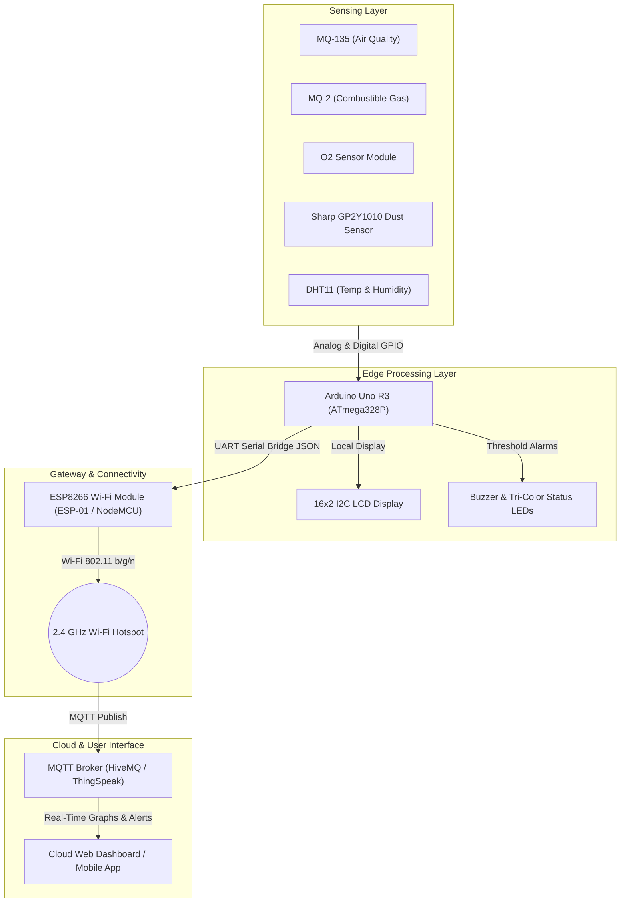

# AirGuard IoT

> **An IoT-Based Smart Air Quality, Gas Leakage, and Environmental Monitoring System Using Arduino Uno and Cloud Computing**

[](https://github.com/fahadrahman444/AirGuard-IOT)
[](https://www.arduino.cc/)
[](https://mqtt.org/)
[](LICENSE)

---

## Academic Information

* **Course Code:** CSE402
* **Course Title:** Internet of Things Lab
* **Semester:** Autumn 26
* **Institution:** University of Information Technology and Sciences (UITS)
* **Submitted to:** Abrar Mahbub Tanim, Lecturer
* **Submitted by:** MD Fahad Rahman
  * **Student ID:** `0432320005101071`
  * **Section:** 6B1
  * **Department:** Department of Computer Science & Engineering (CSE)

---

## 1. Project Overview

**AirGuard IoT** is an end-to-end edge-to-cloud environmental monitoring station designed to detect atmospheric degradation, combustible gas leaks, oxygen depletion, and airborne dust particles in real time. 

By combining the deterministic data acquisition of an **Arduino Uno R3** with the wireless networking capabilities of an **ESP8266 Wi-Fi** module, the system bridges local embedded sensing with cloud telemetry over the lightweight **MQTT** protocol.

---

## 2. Key Features

- **Multi-Gas Air Quality Monitoring:** Continuously quantifies indoor/ambient air pollution (CO₂, NH₃, benzene, smoke) via an MQ-135 sensor.
- **Harmful Gas Leakage Detection:** Detects flammable and toxic gas leaks (LPG, propane, methane) with an MQ-2 sensor to avoid fire hazards.
- **Oxygen Concentration Measurement:** Real-time percentage measurement (% O₂) using an electrochemical oxygen sensor to prevent asphyxiation in confined spaces.
- **Particulate Matter (Dust) Detection:** Optical dust sensing (Sharp GP2Y1010AU0F) to assess fine suspended particulates in µg/m³.
- **Climate Monitoring:** Digital temperature and relative humidity tracking using a DHT11/DHT22 sensor.
- **Dual-Layer Alert System:** Instantaneous on-site audio-visual alarms (active buzzer + tri-color LEDs + 16x2 LCD) paired with remote cloud notifications.
- **Cloud Dashboard Telemetry:** Periodic edge-to-cloud publication over MQTT for real-time charting, historical trend analysis, and automated alerts.

---

## 3. System Architecture



---

## 4. Repository Structure

```
AirGuard-IOT/
├── docs/
│   └── project_proposal.md         # Official CSE402 Project Proposal
├── hardware/
│   ├── pinout.md                   # Pin mapping & wiring schematics
│   └── bill_of_materials.md        # Complete components list & specifications
├── firmware/
│   ├── arduino_airguard/
│   │   └── arduino_airguard.ino    # Arduino Uno sensor polling & display sketch
│   └── esp8266_gateway/
│       └── esp8266_gateway.ino     # ESP8266 Wi-Fi & MQTT publishing gateway
├── .gitignore                      # Git ignore rules for embedded development
└── README.md                       # Main project documentation
```

---

## 5. Hardware Pinout Quick Reference

| Sensor / Module | Sensor Pin | Arduino Uno Pin | Function |
| :--- | :--- | :--- | :--- |
| **MQ-135** | AOUT | **A0** | Analog Air Quality Voltage |
| **MQ-2** | AOUT | **A1** | Analog Gas Concentration Voltage |
| **O₂ Sensor** | AOUT | **A2** | Analog Oxygen Voltage |
| **Sharp GP2Y1010** | V0 / LED | **A3** / **D7** | Dust Analog Output & LED Trigger |
| **DHT11 / DHT22** | DATA | **D4** | One-Wire Climate Telemetry |
| **16×2 I2C LCD** | SDA / SCL | **A4** / **A5** | Hardware I2C Bus |
| **Active Buzzer** | POS (+) | **D8** | Acoustic Alarm Trigger |
| **Tri-Color LEDs** | Green / Yellow / Red | **D9** / **D10** / **D11** | Visual Safety Indicators |
| **ESP8266** | RX / TX | **D3 (Soft TX)** / **D2 (Soft RX)** | UART Serial Communication (via voltage divider) |

*For complete electrical schematics and resistor values, consult [hardware/pinout.md](hardware/pinout.md).*

---

## 6. Getting Started

### Prerequisites
* [Arduino IDE 2.x](https://www.arduino.cc/en/software)
* Installed Arduino Libraries (via Library Manager):
  * `DHT sensor library` by Adafruit
  * `LiquidCrystal_I2C` by Frank de Brabander
  * `PubSubClient` by Nick O'Leary

### Flashing Firmware
1. **Arduino Uno Edge Node:**
   - Open `firmware/arduino_airguard/arduino_airguard.ino` in Arduino IDE.
   - Select Board: **Arduino Uno** and your serial COM port.
   - Click **Upload**.
2. **ESP8266 Gateway:**
   - Open `firmware/esp8266_gateway/esp8266_gateway.ino`.
   - Update `WIFI_SSID` and `WIFI_PASSWORD` with your network credentials.
   - Select Board: **Generic ESP8266 Module** (or **NodeMCU 1.0**).
   - Click **Upload**.

---

## 7. License

This project is licensed under the [MIT License](LICENSE).
